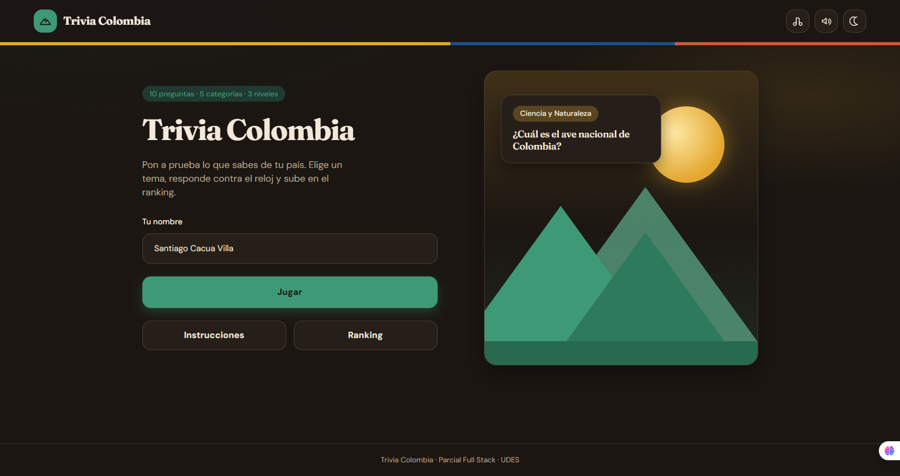
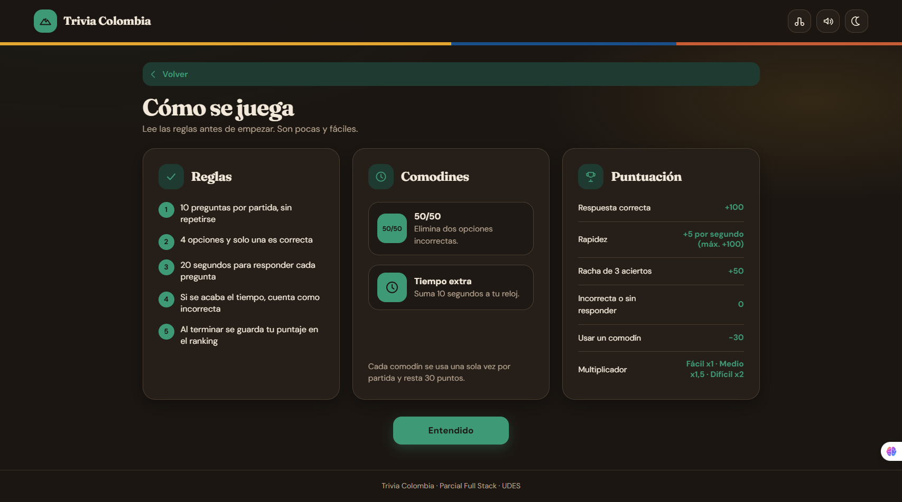
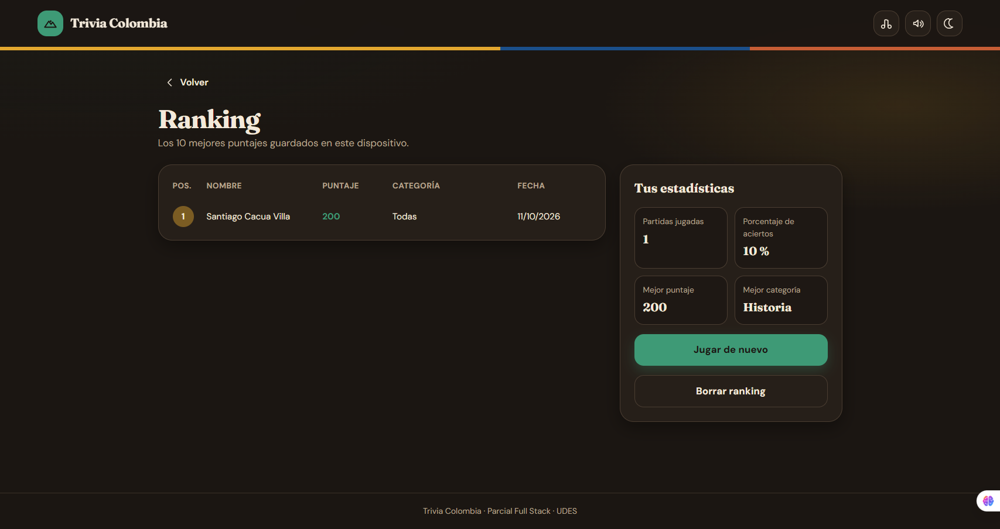
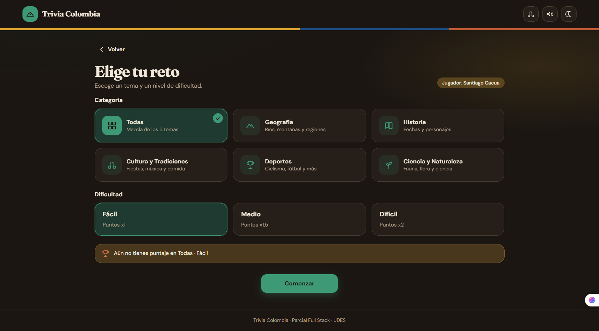
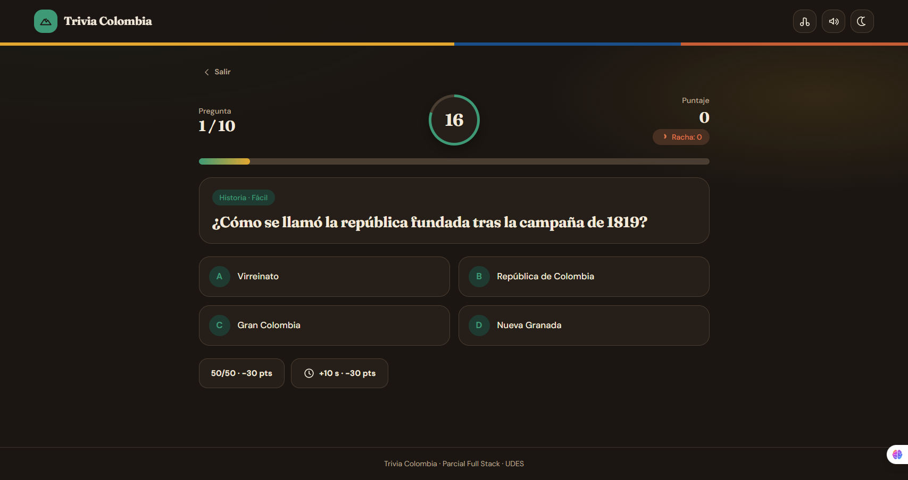
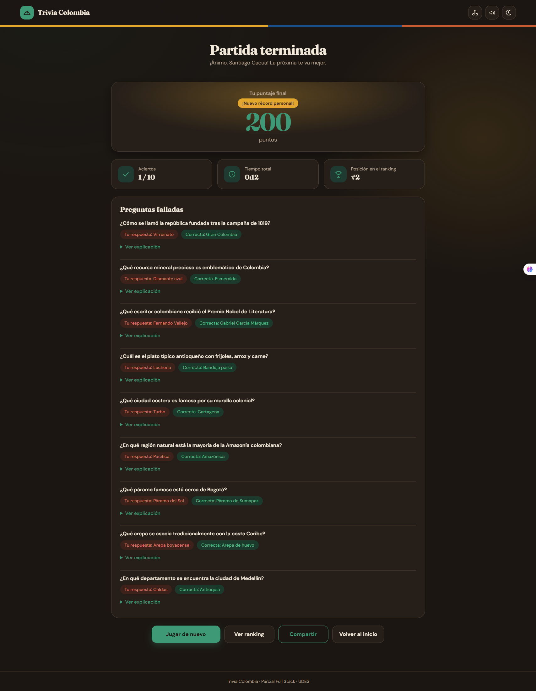

# Trivia Colombia

Trivia educativa sobre Colombia: geografía, historia, cultura y más. Proyecto front-end estático listo para ampliar con lógica de juego e interfaz.

## Tecnologías

- HTML5
- CSS3
- JavaScript (ES modules)
- Google Fonts (Fraunces, DM Sans)

## Cómo ejecutar

1. Abre el proyecto en Visual Studio Code (o Cursor).
2. Instala la extensión **Live Server** si aún no la tienes.
3. Haz clic derecho en `index.html` → **Open with Live Server**.
4. El navegador abrirá la app; revisa la consola: debe aparecer `Trivia Colombia lista`.

> Nota: los módulos ES requieren un servidor local; no abras `index.html` con `file://`.

## Estructura del proyecto

```
trivia-colombia/
├── index.html
├── css/
│   ├── styles.css
│   └── responsive.css
├── js/
│   ├── app.js
│   ├── juego.js
│   ├── preguntas.js
│   ├── ui.js
│   └── almacenamiento.js
├── assets/
│   ├── img/
│   └── sonidos/
├── docs/
│   └── diseno/
├── .gitignore
└── README.md
```

## Capturas de pantalla

### Inicio

Pantalla de bienvenida. El jugador escribe su nombre y puede empezar la partida, leer las instrucciones o consultar el ranking. El resumen indica 10 preguntas, 5 categorías y 3 niveles de dificultad.



### Instrucciones

Reglas de la partida, comodines (50/50 y tiempo extra) y tabla de puntuación: acierto, rapidez, racha, fallo y multiplicador según la dificultad.



### Ranking

Los 10 mejores puntajes guardados en el dispositivo, con posición, nombre, puntaje, categoría y fecha. Al lado se muestran las estadísticas del jugador: partidas, porcentaje de aciertos, mejor puntaje y mejor categoría.



### Elección del reto

Antes de jugar se elige la categoría (Todas, Geografía, Historia, Cultura y Tradiciones, Deportes o Ciencia y Naturaleza) y la dificultad (Fácil x1, Medio x1,5 o Difícil x2).



### Pregunta

Durante la partida se ve el avance (pregunta 1 de 10), el tiempo restante, el puntaje y la racha. Cada pregunta tiene cuatro opciones y dos comodines de un solo uso.



### Resultado

Al terminar se muestra el puntaje final, los aciertos, el tiempo total y la posición en el ranking. Las preguntas falladas incluyen la respuesta elegida, la correcta y la opción de ver la explicación.



## Enlaces

- **Diseño de baja fidelidad (MockFlow):** [wireframes](https://app.mockflow.com/iview/M140ac7642b7628a7f95fe02f28ede1201791659132890)
- **Diseño de alta fidelidad (Figma):** [Trivia Colombia — Alta fidelidad](https://www.figma.com/design/Y4QAI7D6COpBAskkUiT79q/Trivia-Colombia---Alta-fidelidad?node-id=3-2&t=b943CTKINYSx7lxm-1)
- **OneDrive del proyecto/video:** [carpeta compartida](https://mailudesedu-my.sharepoint.com/:f:/g/personal/01220371021_mail_udes_edu_co/IgDsfnpauS0OR6GlqRevftXMAUq5xB5Qek5nmKjSykB-RSs?e=Too97N)
- **Vercel:** [Trivia Colombia](https://trivia-colombia-hyb4fz4xp-xkqaxs-projects.vercel.app/#inicio)
